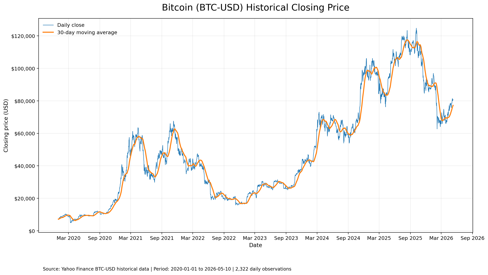

# Exploratory Data Analysis (EDA): Bitcoin Historical Prices

**Author:** Muhammad Adjie Daud  
**Dataset:** BTC-USD historical prices  
**Source reference:** [Yahoo Finance — BTC-USD Historical Data](https://finance.yahoo.com/quote/BTC-USD/history/)  
**Observation period:** 2020-01-01 to 2026-05-10

## 1. Objective

This report summarizes the initial exploratory analysis of the selected Bitcoin historical dataset. It documents the observation period, structure, basic data-quality checks, descriptive statistics, and a visualization of closing prices before any forecasting model is applied.

## 2. Dataset Summary

| Attribute | Result |
|---|---|
| Asset | Bitcoin (BTC) |
| Trading pair | BTC-USD |
| Frequency | Daily |
| Start date | 2020-01-01 |
| End date | 2026-05-10 |
| Daily observations | 2,322 |
| Columns | 7 |
| Columns present | Date, Adj Close, Close, High, Low, Open, Volume |
| Original row ordering | Newest to oldest |
| Analysis ordering | Sorted oldest to newest |

## 3. Data Quality Checks

| Check | Result |
|---|---:|
| Missing cells | 0 |
| Duplicate dates | 0 |
| Missing calendar dates in the period | 0 |
| Negative numeric values | 0 |
| OHLC consistency violations | 0 |
| Rows where Adj Close equals Close | 2,322 of 2,322 |

The date range contains exactly 2,322 calendar days inclusive, matching the 2,322 unique daily observations. The source file is ordered from newest to oldest, so the records were sorted chronologically for the visualization and moving-average calculation.

## 4. Descriptive Statistics for Closing Price

| Statistic | Value |
|---|---:|
| Minimum close | USD 4,970.79 |
| Date of minimum close | 2020-03-12 |
| Maximum close | USD 124,752.53 |
| Date of maximum close | 2025-10-06 |
| Mean close | USD 48,814.77 |
| Median close | USD 42,237.92 |
| Closing price on final date (2026-05-10) | USD 80,897.60 |
| Minimum daily volume | 5,331,172,801 |
| Maximum daily volume | 350,967,941,479 |

## 5. Historical Price Visualization

The chart presents daily closing prices and a 30-observation moving average (30-day moving average on daily data). The moving average smooths short-term movements and helps show the broad historical trend. It is a descriptive visualization, not a forecast.

## 6. Interpretation

The dataset shows substantial variation in Bitcoin's closing price during the observation period. The mean closing price is higher than the median, which is consistent with periods of elevated prices affecting the distribution. The minimum and maximum values summarize the observed historical range; they do not predict future prices.

## 7. Preparation for Forecasting

Before fitting any forecasting model:

1. Use ascending chronological order.
2. Confirm the selected target column matches the research specification.
3. Keep preprocessing consistent with the verified research method.
4. Separate training and evaluation periods in chronological order to avoid data leakage.
5. Report model results only after calculating them from the selected dataset.

## 8. Project Status

**Status:** Initial EDA and data-quality summary documented.  
**Next step:** Prepare the forecasting dataset and document the modeling and evaluation procedure using verified research outputs.

## 9. Scope Note

These descriptive results are based on the uploaded Excel dataset selected for this portfolio. Historical cryptocurrency prices are volatile; this analysis is academic and is not investment advice.
